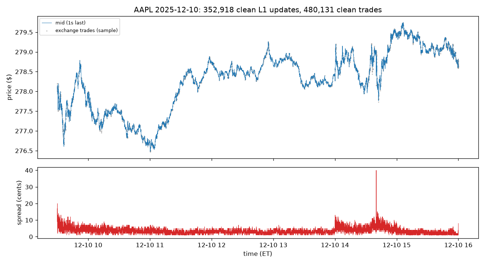
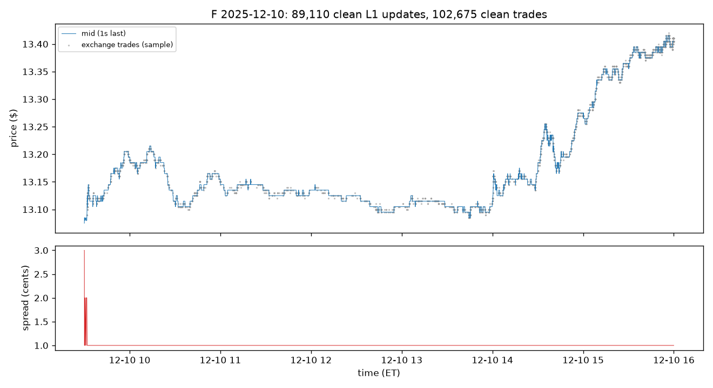

# Cleaning sanity check — 2025-12-10

## AAPL

**nbbo** (raw rows: 355,025)

| reason | rows | share |
|---|---:|---:|
| kept | 352,918 | 99.41% |
| locked | 1,663 | 0.47% |
| duplicate_state | 299 | 0.08% |
| crossed | 145 | 0.04% |

**trades** (raw rows: 502,024)

| reason | rows | share |
|---|---:|---:|
| kept | 480,131 | 95.64% |
| sale_condition | 21,877 | 4.36% |
| corrected | 16 | 0.00% |

Dropped sale-condition codes (top 8): `@4 I` 19,305, `@4 W` 1,574, `@7 I` 801, `@  W` 65, `@7 V` 55, `@4` 39, `C  I` 25, `C` 3

## F

**nbbo** (raw rows: 92,187)

| reason | rows | share |
|---|---:|---:|
| kept | 89,110 | 96.66% |
| locked | 2,973 | 3.22% |
| duplicate_state | 104 | 0.11% |

**trades** (raw rows: 116,052)

| reason | rows | share |
|---|---:|---:|
| kept | 102,675 | 88.47% |
| sale_condition | 13,375 | 11.53% |
| corrected | 2 | 0.00% |

Dropped sale-condition codes (top 8): `4 I` 7,032, `4 B` 5,287, `B` 990, `7 V` 37, `4` 24, `Q` 3, `X` 1, `O` 1
