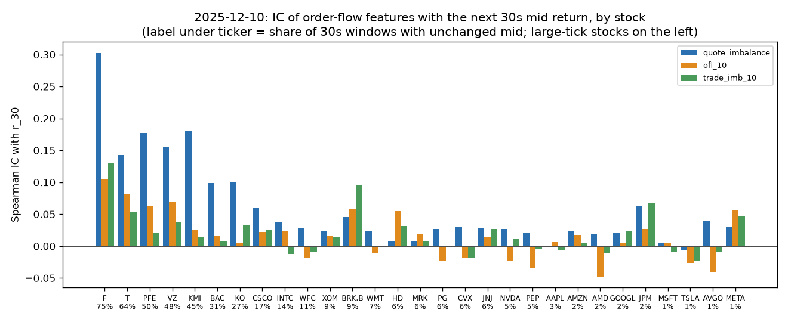
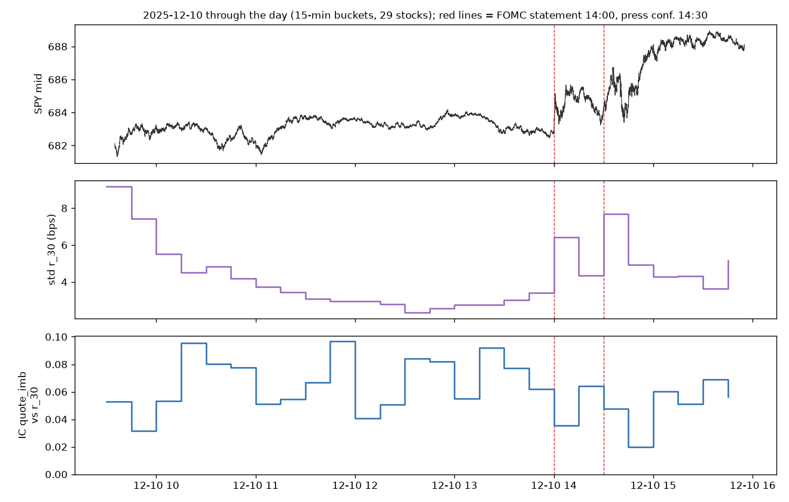

# Dev-day findings — 2025-12-10 (descriptive, no models)

29 pilot stocks + SPY, 1-second grid 09:35–15:55. IC = Spearman correlation between a feature at t and the mid return over the next h seconds, computed per stock and averaged across stocks. **One day only, with overlapping labels** (a new 30 s label every second), so treat these as first impressions, not statistically established results.

## 1. Quote imbalance is the strongest signal

| feature | IC r_5 | IC r_10 | IC r_30 | IC r_60 |
|---|---:|---:|---:|---:|
| quote_imbalance | 0.098 | 0.084 | 0.060 | 0.047 |
| microprice_dev | 0.097 | 0.083 | 0.060 | 0.048 |
| ofi_1 | 0.037 | 0.031 | 0.019 | 0.014 |
| ofi_10 | 0.029 | 0.026 | 0.016 | 0.015 |
| trade_imb_10 | 0.026 | 0.024 | 0.019 | 0.021 |
| ret_30 | −0.000 | −0.002 | −0.006 | −0.005 |
| ret_300 | 0.002 | −0.002 | −0.010 | −0.011 |

- Quote imbalance and microprice deviation have positive IC in 27–28 of 29 stocks. Their signal decays as the horizon grows, as expected for order-book signals.
- OFI and trade imbalance are weaker on average at 30 s. Past returns show slight mean reversion (negative IC).
- The paper finds trade imbalance most important. Our setup differs (mid target, 1-second grid, cumulative windows), so this is not a contradiction.

## 2. Predictability is concentrated in large-tick stocks

Quote-imbalance IC at 30 s is 0.30 for F and 0.14–0.18 for T, PFE, KMI and VZ: stocks whose spread is pinned at one tick and whose mid is unchanged over 30 s 45–75% of the time. For high-priced, small-tick stocks (AAPL, MSFT, TSLA, AMD) it is close to zero. This matches the paper (predictability falls with share price) and the market-microstructure literature: with a one-tick spread, queue sizes reveal which side is about to be depleted. The breakdowns by spread-in-ticks and price level in Step 10 matter for this reason.

## 3. Spread and volatility "signals" mostly reflect the day's market direction

Spread and volatility features showed positive IC (spread 0.046, `rv_300` 0.032), even though they say nothing about direction. After removing each stock's market component (beta × SPY's 30 s return):

| feature | IC raw | IC market-adjusted |
|---|---:|---:|
| spread_bps | 0.046 | 0.028 |
| rv_300 | 0.032 | 0.008 |
| quote_imbalance | 0.060 | 0.061 |

The widest-spread fifth of seconds coincides with SPY's largest moves (the FOMC rally: SPY +54 bps between 14:30 and 15:00). On a single trending day, "high volatility → up" looks predictive but won't generalize. The walk-forward evaluation across days (Step 8) will test this; quote imbalance is unaffected by the adjustment.

## 4. Through the day, including the FOMC announcement

- Volatility follows the usual U-shape (high at the open, low at midday) with spikes at 14:00 (statement) and 14:30 (press conference).
- Quote-imbalance IC stays positive throughout (0.02–0.10 per 15-min bucket) but is lowest during the post-FOMC volatility, when prices move on news rather than order-book pressure.

## Takeaways for the pilot month

1. Expect predictability to come mainly from L1 imbalance features and large-tick stocks, so report results by tick size.
2. Single-day "signals" such as spread or volatility can reflect market drift; pooling 21 days and walk-forward testing will separate real signals from day effects.
3. FOMC days (03-19 in the pilot) behave differently; flag them in the breakdowns.
